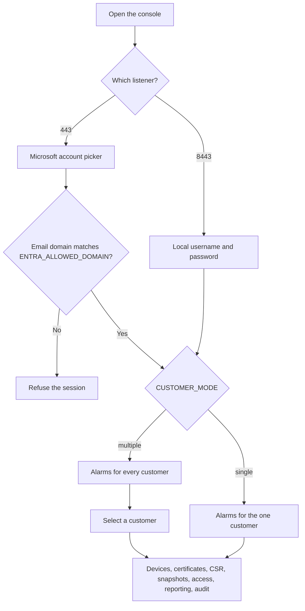
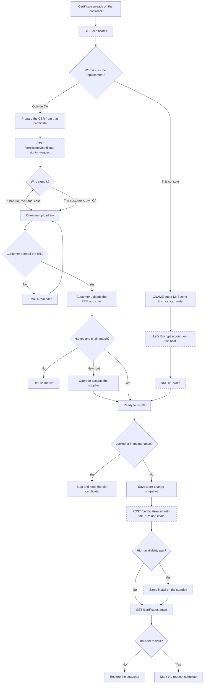
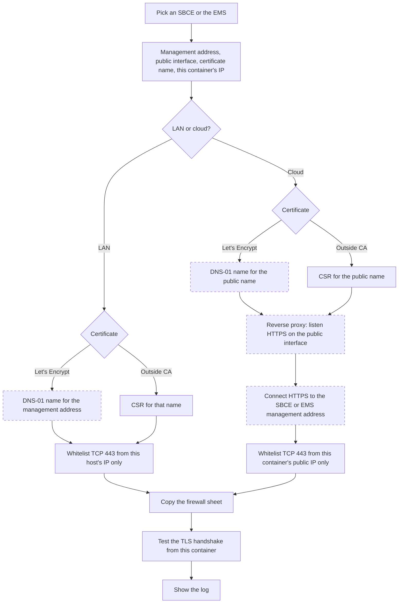
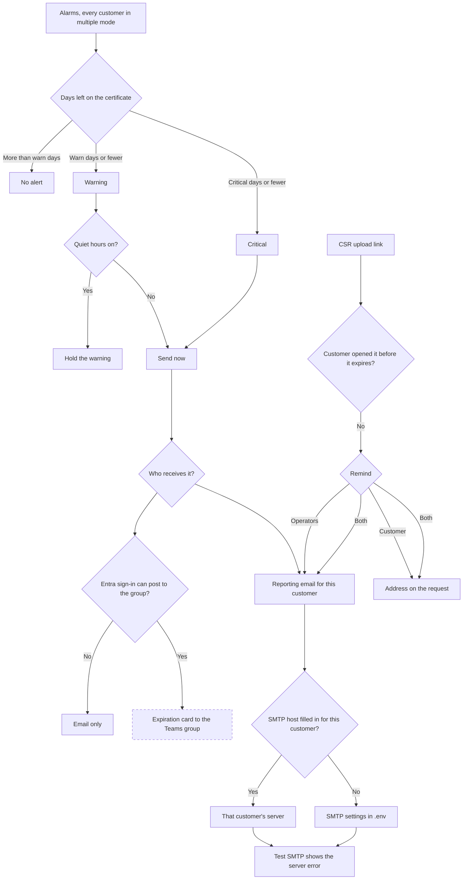

# Avaya SBCE Manager

Console for certificate work on Avaya Session Border Controller for Enterprise 10.2. One place tracks every customer, every controller, and every trunk or remote-worker certificate, and it keeps a way back before anything is written.

## What it does

- Holds one customer or many. `CUSTOMER_MODE=multiple` is the default and keeps the customer list. `CUSTOMER_MODE=single` keeps one customer, named by `CUSTOMER_NAME`, and hides the customer picker, add customer, and remove customer.
- Watches expiration and shows alarms across every customer. The other pages stay on the customer you select.
- Renews a certificate in one of two ways. An outside CA signs a CSR, usually a public CA and sometimes the customer's own CA, or this console manages the name with Let's Encrypt.
- Sends the customer a temporary upload link. The link only accepts a certificate that matches the one it is replacing, including the names and the chain. It records whether they opened it, and it can send a reminder.
- Takes a snapshot before a certificate or TLS profile change, and can put that snapshot back.
- Reports what is due by email. Each customer can use its own SMTP server. A test button shows the mail server’s error instead of pretending the message was sent.
- Checks that a controller can be reached on the LAN, or through the SBCE reverse proxy on the internet. Both use TLS. The SBCE firewall allows only this container.
- Signs people in with Microsoft Entra ID on port 443. A local account on port 8443 still works if Entra does not.

## How it works

1. An administrator signs in. Entra ID is accepted only when the account’s email domain matches `ENTRA_ALLOWED_DOMAIN`. Port 8443 uses a local username and password and does not go to Microsoft.
2. The console keeps customers, devices, certificates, and the audit log in the browser that signed in. Two browsers do not share that data.
3. The design of a change is a snapshot first, then `POST /certificates/{certificateType}` with the PEM and the trust chain. A private key is not sent on that call. The console re-reads with `GET /certificates`. If `notAfter` did not move, the snapshot is what you restore.
4. For an outside CA, the console prepares the CSR from the certificate already on the trunk. The design is to post that body to `POST /certificates/certificate-signing-request`. A public CA is the usual signer. The customer's own CA is the other option. The same upload link takes the signed certificate and chain either way, and the console checks it before install. That CSR call accepts only RSA 2048 or 4096. For a managed certificate, the customer's name is a CNAME to a DNS zone this host can write, Let's Encrypt answers DNS-01, and the issued chain is installed on both members of a high-availability pair. The dashed boxes in the flows below are the calls that are not connected yet.
5. Caddy terminates HTTPS for this console. Port 443 is the Entra listener. Port 8443 is the local administrator listener and the only place the reachability test and SMTP send from.

## Flows

Solid boxes already run. Dashed boxes are recorded here and are not called yet.





An ECDSA Teams key cannot use the CSR call. Avaya accepts only RSA 2048 or 4096 there. Teams Direct Routing stays on the Let's Encrypt path.





Each customer sets the clock. Warning and critical are numbers of days, not a fixed time of day. The samples use 30 and 7, 21 and 7, and 14 and 3. Quiet hours holds a warning only. A critical alert still sends. The quiet-hours flag does not store a start or end time. The message can include the severity, customer, site, device, certificate name, expiration, days remaining, and TLS profiles. The reporting email is the operator list. A customer address is used only for a CSR reminder. SMTP is the customer's host, port, user, from address, and implicit TLS on 465, or the host `.env` when the host is left blank. A CSR link records whether they opened it, when, and how many reminders were sent. The link itself expires.

The whitelist source is a reserved IP or CIDR, shared by every customer on this console. The API does not take a domain as a source. The domain is the name on the certificate. An EMS relay listens on an SBCE public interface and connects to the EMS. A high-availability member has its own public name. Let's Encrypt is the default for that name. The sheet stays a draft until the listen certificate is installed and a lab controller answers `https://{name}:{port}/api/auth/v1/token`.

## Reaching a controller

Open **Access**, pick the SBCE or the EMS, and enter:

- The management address. For an EMS this is the EMS, not the SBCE.
- For cloud, the public interface IP, a listen port, and the public name that will be on the certificate. 443, 5060, 5061, 3478, and 50000–55000 are refused because the 10.2 configuration uses them for the management API, SIP, TURN, or media. 9443 is the suggested port. 8443 and 8080 are allowed with a warning.
- Let's Encrypt or an outside CA. Let's Encrypt prints the DNS-01 name. An outside CA prints the common name and subject alternative name for the same CSR used on a trunk.
- This container's IP. That is the only firewall source. A domain is not a valid source.

The page prints the sheet. On the LAN it is a whitelist only, and the management interface stays private. In the cloud it is a reverse proxy relay that listens HTTPS on the public name and connects HTTPS to the management address, plus the whitelist. Copy it onto the SBCE. **Test access** checks the TLS handshake.

The console does not create the relay, the whitelist, or the certificate yet. No configuration API call is made until Test access succeeds. The API user, when one is stored, is limited to certificate read, create, and install, plus the TLS profile calls. Its password stays on the server, not in the browser.

## Closed

- The listen port is chosen. 443, 80, 5060, 5061, 3478, and 50000–55000 are refused. 9443 is the suggestion.
- The listen certificate is installed before the relay. Let's Encrypt is the default. An outside CA uses the trunk CSR path and stays RSA 2048 or 4096.
- Cloud mode allow-lists one reserved address for this container, on every customer.
- One public name per high-availability member. After a write, both members are read.
- The previous certificate and the audit have to be stored on this server before the first live install. The browser copy is not enough.

Still to finish, and only these:

1. On a lab controller, prove the reverse proxy returns `POST /api/auth/v1/token`. If it does not, keep LAN, or put a TLS proxy in front of the management address. Do not force the SBCE relay.
2. Post the prepared CSR, run the DNS-01 order, install with `POST /certificates/{certificateType}`, and re-read both members. Nothing is sent to the SBCE today.
3. Move the previous certificate and the audit onto the server before that first install.
4. After Entra sign-in, ask that account for permission to post to the customer's group. The card is still a preview.

Do the steps below in order. Starting Docker before DNS and the firewall is the usual reason the first certificate request fails.

What you need before step 1:

- A public name, such as `sbce.example.com`
- The address of this host. Both listeners use it. There is no separate management network.

## Sample walk

Sign in on port 8443 as `admin` / `harbor-admin`, or use **Reset demo** if this browser already has older data. This walk uses `CUSTOMER_MODE=multiple`. Each customer is one module:

| Customer | Open | What you can touch |
| --- | --- | --- |
| All | Alarms | Certificates due across every customer. Open one to land on that device. |
| UMCSN | Devices, Certificates, Snapshots | A high-availability pair. Genesis is a public CA. The EMS certificate is the customer's own CA. Teams Direct Routing is Let's Encrypt, with the DNS-01 name filled in. Both controllers are on the LAN, allowed from `10.40.8.8/32`. One snapshot is marked known good. The audit has a failed re-read. |
| Harbor Health | CSR requests, Reporting, Access | A CSR prepared from the remote-worker certificate, waiting on the customer. Upload link `#/upload/upl_harbor_demo`. SMTP is filled with `smtp.yourdomain.com`. Access prints a cloud relay for `sbce.harbor.example` on `203.0.113.21`, connecting to `172.16.4.15`, allowed from `203.0.113.10/32`, with an outside-CA certificate. |
| Northline Transit | Access, CSR requests | Access prints a cloud relay for `sbce.northline.example` with a Let's Encrypt certificate. The Nice trunk is waiting because the public CA root changed. |

## 1. Install Docker and git

Rocky, RHEL, or Alma:

```bash
sudo dnf -y install git dnf-plugins-core
sudo dnf config-manager --add-repo https://download.docker.com/linux/centos/docker-ce.repo
sudo dnf -y install docker-ce docker-ce-cli containerd.io docker-compose-plugin firewalld
sudo systemctl enable --now docker
sudo docker version
sudo docker compose version
```

Ubuntu:

```bash
sudo apt-get update
sudo apt-get -y install git ca-certificates curl
sudo install -m 0755 -d /etc/apt/keyrings
sudo curl -fsSL https://download.docker.com/linux/ubuntu/gpg -o /etc/apt/keyrings/docker.asc
sudo chmod a+r /etc/apt/keyrings/docker.asc
echo "deb [arch=$(dpkg --print-architecture) signed-by=/etc/apt/keyrings/docker.asc] https://download.docker.com/linux/ubuntu $(. /etc/os-release && echo "$VERSION_CODENAME") stable" | sudo tee /etc/apt/sources.list.d/docker.list > /dev/null
sudo apt-get update
sudo apt-get -y install docker-ce docker-ce-cli containerd.io docker-compose-plugin
sudo systemctl enable --now docker
sudo docker version
sudo docker compose version
```

On Debian, change `ubuntu` in that repository line to `debian`.

## 2. Clone

Clone as your user, not as root. A root-owned checkout makes the next `git pull` fail.

```bash
sudo mkdir -p /opt/avaya-sbce-manager
sudo chown "$USER:$USER" /opt/avaya-sbce-manager
git clone https://github.com/bmiles-git/avaya-sbce-manager.git /opt/avaya-sbce-manager
cd /opt/avaya-sbce-manager
git checkout main
```

## 3. Set the public name

```bash
cd /opt/avaya-sbce-manager
cp .env.example .env
```

Edit `.env`:

```bash
SITE_ADDRESS=avaya-sbc.aws.yourdomain.com
ENTRA_TENANT_ID=
ENTRA_CLIENT_ID=
ENTRA_REDIRECT_URI=https://avaya-sbc.aws.yourdomain.com
ENTRA_ALLOWED_DOMAIN=yourdomain.com
CUSTOMER_MODE=multiple
CUSTOMER_NAME=
SMTP_HOST=smtp.example.com
SMTP_PORT=587
SMTP_USER=
SMTP_PASS=
SMTP_FROM=sbce@example.com
```

`Continue with Entra ID` redirects to Microsoft. Access is granted when the account's email domain matches `ENTRA_ALLOWED_DOMAIN`. Any other account is refused. The default is `yourdomain.com`. In Entra, register an app:

1. App registrations, new registration. Supported account types: this directory only.
2. Redirect URI platform: Single-page application. URI: `https://avaya-sbc.aws.yourdomain.com` with no path and no port.
3. Copy the Application (client) ID into `ENTRA_CLIENT_ID` and the Directory (tenant) ID into `ENTRA_TENANT_ID`.
4. Under Authentication, leave implicit grant off. The browser uses the authorization code with PKCE.
5. Assign the people who should open the console, or leave assignment open if everyone in that domain should be able to try. The console still refuses an account outside `ENTRA_ALLOWED_DOMAIN`.

A matching account is an administrator of this console. After changing `.env`, run `sudo docker compose up -d` so the container sees the tenant, client ID, and domain. Sign out of any session that was created before this change.

`CUSTOMER_MODE` is `multiple` or `single`. Multiple is the sample walk below: alarms cover every customer, and the sidebar has a customer list. Single is one installation for one customer. Set `CUSTOMER_NAME` to that customer's name. The sidebar shows the name and does not offer a list. Add customer, remove customer, and the per-user customer picker are hidden. Devices, certificates, CSR requests, and reporting are unchanged. Leave `CUSTOMER_NAME` empty in single mode to keep whichever customer is already selected.

`SITE_ADDRESS` is the name of this host. Port 443 and port 8443 both listen on every address the host has. `.env` is not committed. Do not edit `Caddyfile` to put the name in it. The next pull would conflict.

Mail is sent only from port 8443. Without `SMTP_HOST` and `SMTP_FROM`, **Send test email** and **Send reminder** stop and show that SMTP is not configured. They do not pretend the message was sent. After changing `.env`, run `sudo docker compose up -d` again so the container sees the new values.

## 4. Publish DNS

Create an A or AAAA record for `sbce.example.com` that points at this host's public address. Wait until it answers:

```bash
getent hosts sbce.example.com
```

Let's Encrypt will not issue a certificate until that name reaches this host from the internet.

## 5. Open the firewall, then start Docker again

Docker publishes 80, 443, and 8443 on the host. Apply the firewall before the first start so those are the only inbound ports.

firewalld:

```bash
sudo systemctl enable --now firewalld
sudo firewall-cmd --permanent --add-service=http
sudo firewall-cmd --permanent --add-service=https
sudo firewall-cmd --permanent --add-port=8443/tcp
sudo firewall-cmd --reload
sudo systemctl restart docker
sudo firewall-cmd --list-all
```

ufw:

```bash
sudo ufw default deny incoming
sudo ufw default allow outgoing
sudo ufw allow 80/tcp
sudo ufw allow 443/tcp
sudo ufw allow 8443/tcp
sudo ufw deny 8080/tcp
sudo ufw deny 8000/tcp
sudo ufw enable
sudo ufw status verbose
sudo systemctl restart docker
```

Outbound, this host also needs tcp/443 to each EMS or SBCE management address, tcp/443 to Let's Encrypt, and DNS to your resolvers. No other inbound port is required.

## 6. Build and start

```bash
cd /opt/avaya-sbce-manager
sudo docker compose build
sudo docker compose up -d
sudo docker compose ps
```

`ps` should show `caddy` and `web`. It should not show `app`. The Python service is not part of this start. Ports 8080 and 8000 should not be listed as `0.0.0.0`.

Watch Caddy until it obtains a certificate. Ctrl-C leaves the containers running.

```bash
sudo docker compose logs -f caddy
```

You want a line that the certificate was obtained for `sbce.example.com`. If it says the name did not resolve or port 80 timed out, fix DNS or the firewall, then:

```bash
sudo docker compose restart caddy
```

## 7. Check both listeners

From this host:

```bash
curl -fsSI https://sbce.example.com
curl -fsSI https://sbce.example.com:8443
```

Both use the Let's Encrypt certificate for `SITE_ADDRESS`. Port 8443 is the same host, not a second network. Device access tests call `/api/probe` on port 8443 only. That request is not served on port 443.

## 8. First sign-in

Open `https://sbce.example.com:8443`. Sign in as `admin` / `harbor-admin`. Open **Users**, set a new admin password, and remove the user `harbor`. **Reset demo** puts both sample passwords back.

An administrator with no customers selected sees every customer. An operator must be assigned at least one.

## 9. Update later

```bash
cd /opt/avaya-sbce-manager
git pull --ff-only
sudo docker compose up -d --build
```

`sudo docker compose down` stops the site and keeps the certificate. `sudo docker compose down -v` deletes the certificate, and the next start asks Let's Encrypt again.

## SBCE firewall

On the 10.2 management interface, allow this host to tcp/443 and leave the default drop. Do not open tcp/222 for this console.

An HA pair is one configuration. This host still needs tcp/443 to both management addresses. The active is written first, then the standby after the health check.

If the management address is private, use LAN. If it is not, use the cloud reverse proxy. The customer does not need that path to return a certificate. The upload link is on port 443 of this console.

For a managed trunk, publish `_acme-challenge.<fqdn>` as a CNAME to the target shown on that certificate. Do not put an HTTP challenge on the SBCE.
