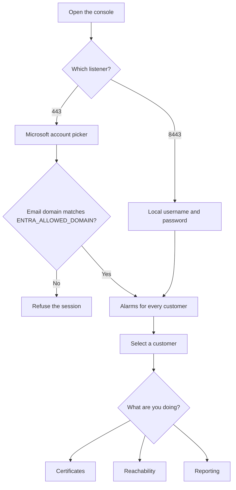
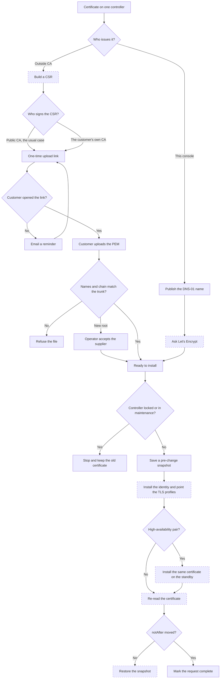
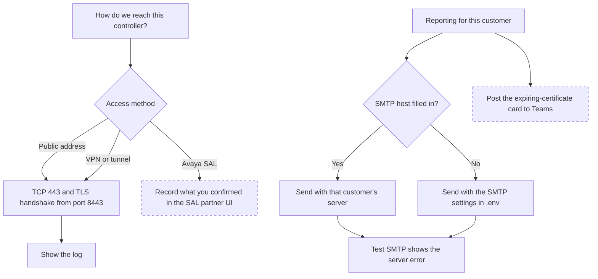

# Avaya SBCE Manager

Console for certificate work on Avaya Session Border Controller for Enterprise 10.2. One place tracks every customer, every controller, and every trunk or remote-worker certificate, and it keeps a way back before anything is written.

## What it does

- Holds customers, sites, and controllers. A high-availability pair is one certificate set: the standby is updated with the active.
- Watches expiration and shows alarms across every customer. The other pages stay on the customer you select.
- Renews a certificate in one of two ways. An outside CA signs a CSR, usually a public CA and sometimes the customer's own CA, or this console manages the name with Let's Encrypt.
- Sends the customer a temporary upload link. The link only accepts a certificate that matches the one it is replacing, including the names and the chain. It records whether they opened it, and it can send a reminder.
- Takes a snapshot before a certificate or TLS profile change, and can put that snapshot back.
- Reports what is due by email. Each customer can use its own SMTP server. A test button shows the mail server’s error instead of pretending the message was sent.
- Checks that a controller can be reached, including through a VPN, a tunnel, or Avaya SAL, and keeps the log of that check.
- Signs people in with Microsoft Entra ID on port 443. A local account on port 8443 still works if Entra does not.

## How it works

1. An administrator signs in. Entra ID is accepted only when the account’s email domain matches `ENTRA_ALLOWED_DOMAIN`. Port 8443 uses a local username and password and does not go to Microsoft.
2. The console keeps customers, devices, certificates, and the audit log in the browser that signed in. Two browsers do not share that data.
3. A certificate change starts with a snapshot of the controller. The write goes to the Avaya configuration API only after that snapshot exists. If the re-read does not show the new certificate, the snapshot is what you restore.
4. For an outside CA, the console builds a CSR and a one-time link. A public CA is the usual signer. The customer's own CA is the other option. The same link takes the signed certificate and chain either way. The console checks it before anyone can install it. For a managed certificate, the public DNS name points at the Let's Encrypt challenge, and the console installs the issued certificate on both members of a high-availability pair.
5. Caddy terminates HTTPS for this console. Port 443 is the Entra listener. Port 8443 is the local administrator listener and the only place the reachability test and SMTP send from.

## Flows

Solid boxes are wired to something outside this page. Dashed boxes are still decided inside the browser. They record the step and the audit line, but they do not call Avaya, Let's Encrypt, or Microsoft Graph yet.







Still to finish, in the order a renewal needs them:

1. A real CSR from the controller, not the sample text the page generates now.
2. A real Let's Encrypt DNS-01 order. The page checks a locally built chain and does not talk to the ACME directory.
3. The Avaya configuration API calls behind install, re-read, and restore. The audit steps are written, and the certificate date moves in this console, but nothing is sent to the SBCE.
4. A SAL session. There is no partner API, so the page only stores that someone checked the hosted UI.
5. The Teams post. The card is previewed here and is not sent through Graph.
6. A store that is not the browser. Two people who sign in do not see the same customers, devices, or audit log.

Do the steps below in order. Starting Docker before DNS and the firewall is the usual reason the first certificate request fails.

What you need before step 1:

- A public name, such as `sbce.example.com`
- The address of this host. Both listeners use it. There is no separate management network.

## 1. Install Docker and git

Rocky, RHEL, or Alma:

```bash
sudo dnf -y install git dnf-plugins-core
sudo dnf config-manager --add-repo https://download.docker.com/linux/centos/docker-ce.repo
sudo dnf -y install docker-ce docker-ce-cli containerd.io docker-compose-plugin firewalld
sudo systemctl enable --now docker
sudo docker version
sudo docker compose version
```

Ubuntu:

```bash
sudo apt-get update
sudo apt-get -y install git ca-certificates curl
sudo install -m 0755 -d /etc/apt/keyrings
sudo curl -fsSL https://download.docker.com/linux/ubuntu/gpg -o /etc/apt/keyrings/docker.asc
sudo chmod a+r /etc/apt/keyrings/docker.asc
echo "deb [arch=$(dpkg --print-architecture) signed-by=/etc/apt/keyrings/docker.asc] https://download.docker.com/linux/ubuntu $(. /etc/os-release && echo "$VERSION_CODENAME") stable" | sudo tee /etc/apt/sources.list.d/docker.list > /dev/null
sudo apt-get update
sudo apt-get -y install docker-ce docker-ce-cli containerd.io docker-compose-plugin
sudo systemctl enable --now docker
sudo docker version
sudo docker compose version
```

On Debian, change `ubuntu` in that repository line to `debian`.

## 2. Clone

Clone as your user, not as root. A root-owned checkout makes the next `git pull` fail.

```bash
sudo mkdir -p /opt/avaya-sbce-manager
sudo chown "$USER:$USER" /opt/avaya-sbce-manager
git clone https://github.com/bmiles-git/avaya-sbce-manager.git /opt/avaya-sbce-manager
cd /opt/avaya-sbce-manager
git checkout main
```

## 3. Set the public name

```bash
cd /opt/avaya-sbce-manager
cp .env.example .env
```

Edit `.env`:

```bash
SITE_ADDRESS=avaya-sbc.aws.yourdomain.com
ENTRA_TENANT_ID=
ENTRA_CLIENT_ID=
ENTRA_REDIRECT_URI=https://avaya-sbc.aws.yourdomain.com
ENTRA_ALLOWED_DOMAIN=yourdomain.com
SMTP_HOST=smtp.example.com
SMTP_PORT=587
SMTP_USER=
SMTP_PASS=
SMTP_FROM=sbce@example.com
```

`Continue with Entra ID` redirects to Microsoft. Access is granted when the account's email domain matches `ENTRA_ALLOWED_DOMAIN`. Any other account is refused. The default is `yourdomain.com`. In Entra, register an app:

1. App registrations, new registration. Supported account types: this directory only.
2. Redirect URI platform: Single-page application. URI: `https://avaya-sbc.aws.yourdomain.com` with no path and no port.
3. Copy the Application (client) ID into `ENTRA_CLIENT_ID` and the Directory (tenant) ID into `ENTRA_TENANT_ID`.
4. Under Authentication, leave implicit grant off. The browser uses the authorization code with PKCE.
5. Assign the people who should open the console, or leave assignment open if everyone in that domain should be able to try. The console still refuses an account outside `ENTRA_ALLOWED_DOMAIN`.

A matching account is an administrator of this console. After changing `.env`, run `sudo docker compose up -d` so the container sees the tenant, client ID, and domain. Sign out of any session that was created before this change.

`SITE_ADDRESS` is the name of this host. Port 443 and port 8443 both listen on every address the host has. `.env` is not committed. Do not edit `Caddyfile` to put the name in it. The next pull would conflict.

Mail is sent only from port 8443. Without `SMTP_HOST` and `SMTP_FROM`, **Send test email** and **Send reminder** stop and show that SMTP is not configured. They do not pretend the message was sent. After changing `.env`, run `sudo docker compose up -d` again so the container sees the new values.

## 4. Publish DNS

Create an A or AAAA record for `sbce.example.com` that points at this host's public address. Wait until it answers:

```bash
getent hosts sbce.example.com
```

Let's Encrypt will not issue a certificate until that name reaches this host from the internet.

## 5. Open the firewall, then start Docker again

Docker publishes 80, 443, and 8443 on the host. Apply the firewall before the first start so those are the only inbound ports.

firewalld:

```bash
sudo systemctl enable --now firewalld
sudo firewall-cmd --permanent --add-service=http
sudo firewall-cmd --permanent --add-service=https
sudo firewall-cmd --permanent --add-port=8443/tcp
sudo firewall-cmd --reload
sudo systemctl restart docker
sudo firewall-cmd --list-all
```

ufw:

```bash
sudo ufw default deny incoming
sudo ufw default allow outgoing
sudo ufw allow 80/tcp
sudo ufw allow 443/tcp
sudo ufw allow 8443/tcp
sudo ufw deny 8080/tcp
sudo ufw deny 8000/tcp
sudo ufw enable
sudo ufw status verbose
sudo systemctl restart docker
```

Outbound, this host also needs tcp/443 to each EMS or SBCE management address, tcp/443 to Let's Encrypt, and DNS to your resolvers. No other inbound port is required.

## 6. Build and start

```bash
cd /opt/avaya-sbce-manager
sudo docker compose build
sudo docker compose up -d
sudo docker compose ps
```

`ps` should show `caddy` and `web`. It should not show `app`. The Python service is not part of this start. Ports 8080 and 8000 should not be listed as `0.0.0.0`.

Watch Caddy until it obtains a certificate. Ctrl-C leaves the containers running.

```bash
sudo docker compose logs -f caddy
```

You want a line that the certificate was obtained for `sbce.example.com`. If it says the name did not resolve or port 80 timed out, fix DNS or the firewall, then:

```bash
sudo docker compose restart caddy
```

## 7. Check both listeners

From this host:

```bash
curl -fsSI https://sbce.example.com
curl -fsSI https://sbce.example.com:8443
```

Both use the Let's Encrypt certificate for `SITE_ADDRESS`. Port 8443 is the same host, not a second network. Device access tests call `/api/probe` on port 8443 only. That request is not served on port 443.

## 8. First sign-in

Open `https://sbce.example.com:8443`. Sign in as `admin` / `harbor-admin`. Open **Users**, set a new admin password, and remove the user `harbor`. **Reset demo** puts both sample passwords back.

An administrator with no customers selected sees every customer. An operator must be assigned at least one.

## 9. Update later

```bash
cd /opt/avaya-sbce-manager
git pull --ff-only
sudo docker compose up -d --build
```

`sudo docker compose down` stops the site and keeps the certificate. `sudo docker compose down -v` deletes the certificate, and the next start asks Let's Encrypt again.

## SBCE firewall

On the 10.2 management interface, allow this host to tcp/443 and leave the default drop. Do not open tcp/222 for this console.

An HA pair is one configuration. This host still needs tcp/443 to both management addresses. The active is written first, then the standby after the health check.

If the management address is private, use the customer VPN or SAL. The customer does not need that path to return a certificate. The upload link is on port 443 of this console.

For a managed trunk, publish `_acme-challenge.<fqdn>` as a CNAME to the target shown on that certificate. Do not put an HTTP challenge on the SBCE.
